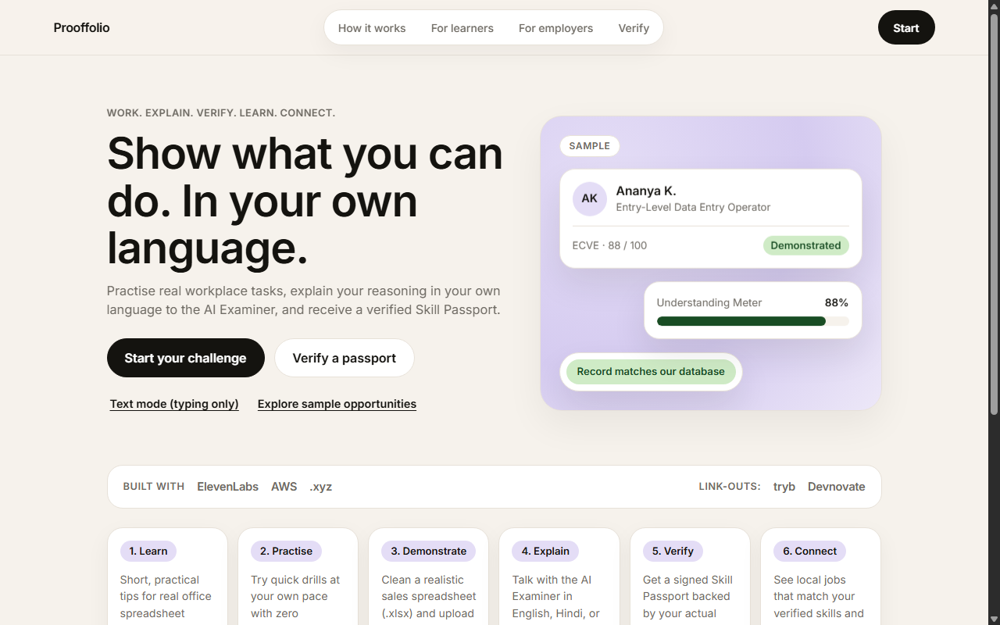
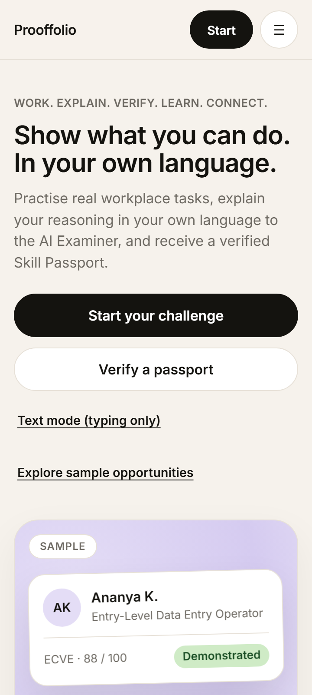
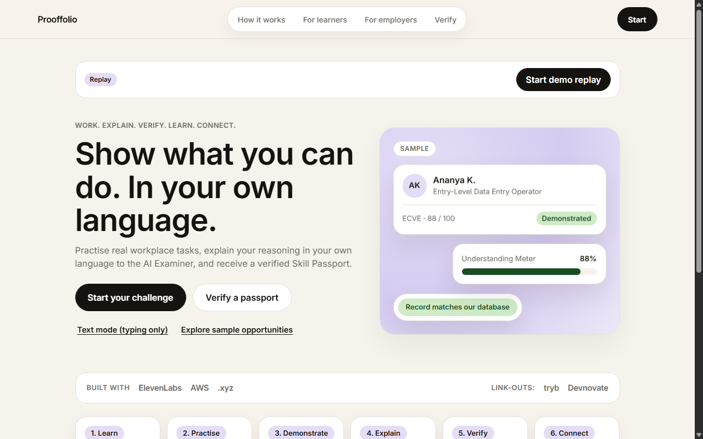
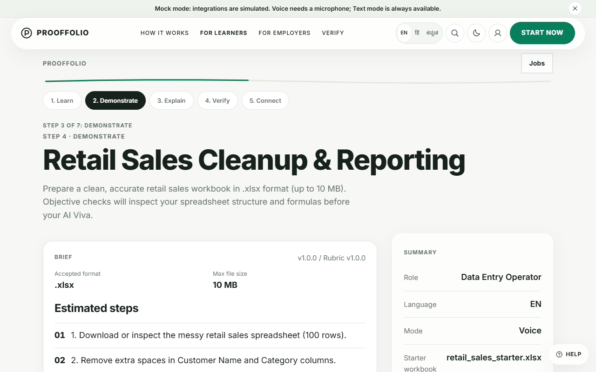
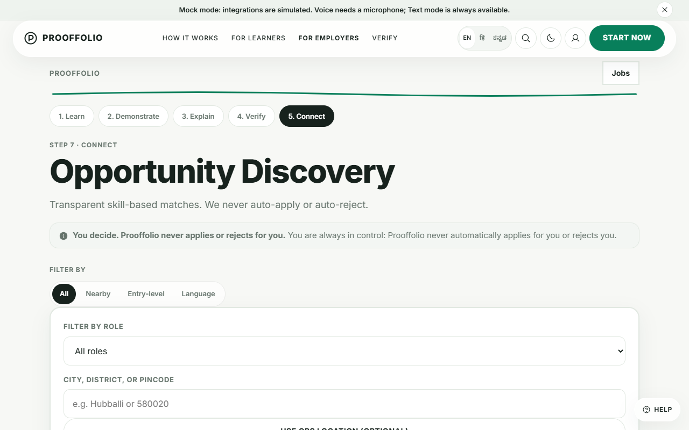
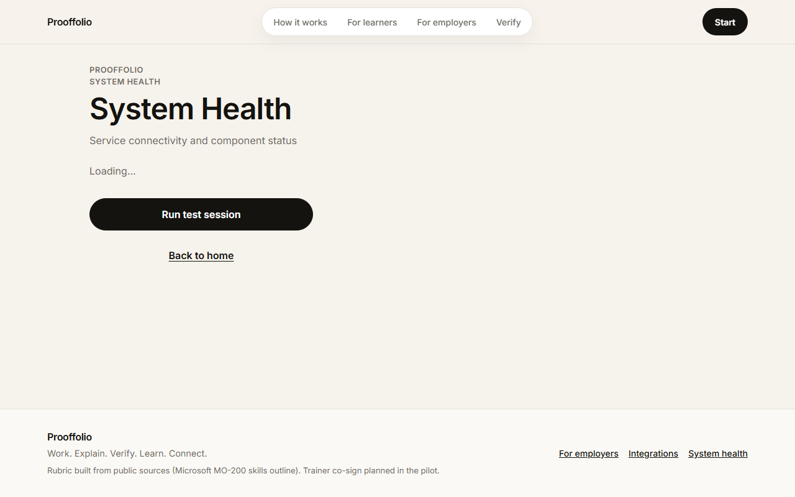
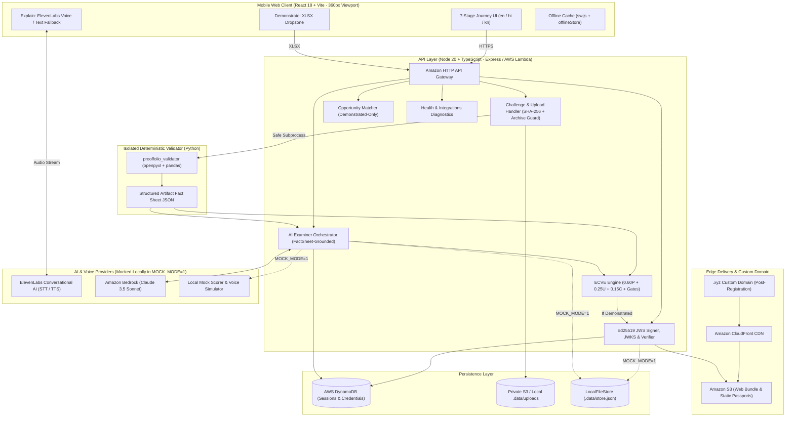
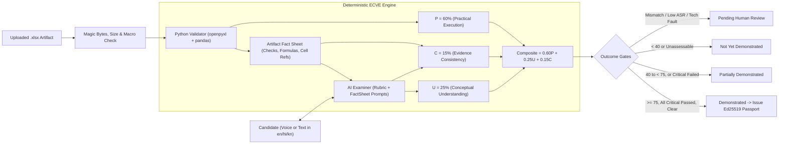
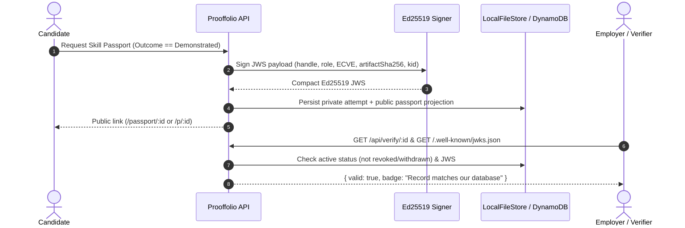

# Prooffolio

> **“Work. Explain. Verify. Learn. Connect.”**  
> An evidence-first, multilingual skill-to-employment platform empowering vocational graduates, non-degree job seekers, and informal learners to demonstrate real-world workplace tasks, explain their reasoning to an artifact-aware AI Examiner, undergo deterministic cross-verification, earn an Ed25519-signed Skill Passport, and discover local entry-level opportunities.

[](https://www.typescriptlang.org/)
[](https://reactjs.org/)
[](https://vitejs.dev/)
[](https://www.python.org/)
[](https://aws.amazon.com/serverless/sam/)
[](https://elevenlabs.io/)
[](https://aws.amazon.com/bedrock/)

---

## 1. Problem & 7-Stage Candidate Journey

Conventional hiring filters out skilled informal and vocational learners: resumes reward English buzzwords, multiple-choice tests measure rote recall instead of job execution, and manual technical interviews do not scale for entry-level roles.

**Prooffolio** replaces self-reported claims with a 7-stage evidence pipeline designed **mobile-first (360px viewport)** with zero passwords and single-tap onboarding in **English (`en`)**, **Hindi (`hi`)**, and **Kannada (`kn`)**:

1. **Learn**: Practical micro-lessons for the MVP role (*Entry-Level Data Entry Operator*), cached for offline study.
2. **Practise**: Low-stakes interactive drills and optional external **tryb** practice link-out.
3. **Demonstrate**: Download a seeded messy workbook (`retail_sales_starter.xlsx`) for *Retail Sales Cleanup & Reporting*, clean it, and upload the `.xlsx` artifact (validated for magic bytes, archive safety, no macros, and SHA-256 fingerprint).
4. **Explain (AI Viva)**: An artifact-aware **AI Examiner** interviews the candidate in `en`, `hi`, or `kn` (voice or **Text mode** fallback) using questions grounded in the deterministic `FactSheet` and challenge rubric.
5. **Cross-Verify (ECVE)**: Deterministic tri-pillar scoring combines Practical Execution ($P = 60\%$), Conceptual Understanding ($U = 25\%$), and Evidence Consistency ($C = 15\%$).
6. **Verify (Skill Passport)**: For authoritative *Demonstrated* outcomes, issues an **Ed25519-signed JWS** bound to the artifact SHA-256 hash, verifiable via `/.well-known/jwks.json`, `/api/verify/:id`, and static HTML `/p/:id`.
7. **Connect**: Weighted, explainable matching against local sample opportunities showing matched skills, skill gaps, and weights—never auto-applying or auto-rejecting.

---

## Screenshots

| Desktop Landing (`1280px`) | Mobile Landing (`360px`) |
|---|---|
|  |  |

| Demo Replay (`?demo=1`) | Challenge & XLSX Upload (`/challenge`) |
|---|---|
|  |  |

| Opportunities Discovery (`/opportunities`) | System Health & Integrations (`/health`, `/integrations`) |
|---|---|
|  |  |

---

## 2. System Architecture

### 2.1 End-to-End Platform & Cloud Architecture



---

### 2.2 Artifact-Grounded AI Viva & ECVE Decision Flow



---

### 2.3 Skill Passport Cryptography & Verification (Ed25519 JWS)



---

## 3. Repository Structure

```text
Whackiest_2k26/
├── web/                  # React 18 + Vite mobile-first frontend (en/hi/kn, offline cache, ?demo=1)
├── api/                  # Node 20 + TypeScript API (Express local server + AWS Lambda handlers)
│   └── src/
│       ├── challenge/    # Seeded XLSX dataset generator & archive/macro safety checks
│       ├── domain/       # Canonical Zod schemas, types & legacy migration helpers
│       ├── ecve/         # Deterministic tri-pillar ECVE scoring & outcome gate engine
│       ├── opportunities/# Demonstrated-only weighted opportunity matcher
│       ├── services/     # Ed25519 JWS passport crypto, lifecycle & static HTML generator
│       ├── validator/    # Node-to-Python validator bridge
│       └── viva/         # Artifact-grounded AI Examiner orchestrator & fallback handling
├── validator/            # Isolated Python validator package (openpyxl + pandas + pytest)
├── rubrics/              # Versioned skill & challenge rubrics (MO-200 / Support public sources)
├── agent/                # AI Examiner system prompt & configuration docs
├── infra/                # AWS SAM template (template.yaml) & deployment notes
├── scripts/              # Preflight config check, smoke test, web deploy & screenshot utilities
├── docs/                 # SRS traceability matrix, migration report, security & demo runbooks
└── tests/                # 20-transcript Anti-Bluff harness & human reviewer calibration scripts
```

---

## 4. Key Routes & API Endpoints

| Surface | Path | Purpose |
|---|---|---|
| **Web Journey** | `/`, `/profile`, `/role`, `/learn`, `/challenge`, `/validation`, `/setup-viva`, `/session` (`/explain`), `/results/:id`, `/passport/:id` (`/skill/:id`), `/opportunities` (`/connect`) | 7-stage mobile-first candidate flow (`?demo=1` for deterministic replay) |
| **Diagnostics** | `/health`, `/integrations` | Live/Mock/Not configured status for store, validator, ElevenLabs, Bedrock, Tryb, Devnovate, `.xyz` |
| **Challenge API** | `GET /api/challenge/:id/starter.xlsx`, `POST /api/challenge/:id/start`, `POST /api/attempt/:id/upload` | Download seeded starter workbook, start attempt, upload & validate XLSX |
| **Viva & ECVE API** | `POST /api/session/start`, `POST /api/session/:id/turn`, `POST /api/session/:id/finish`, `GET /api/session/:id` | Artifact-grounded viva turns, provisional meter & session scoring |
| **Passport & Verify** | `POST /api/session/:id/credential`, `PATCH /api/credential/:pageId/share`, `DELETE /api/credential/:pageId`, `GET /api/verify/:pageId`, `GET /.well-known/jwks.json` | Ed25519 JWS issuance, share toggle, withdrawal, public verification & JWKS |

---

## 5. ECVE Assessment & Opportunity Guardrails

- **Composite Formula**: $\text{Composite} = 0.60P + 0.25U + 0.15C$ (proposed design weights subject to empirical pilot calibration).
- **Four Outcomes**: *Not yet demonstrated* ($<40$), *Partially demonstrated* ($40\text{–}74.99$ or critical criterion failed), *Demonstrated* ($\ge 75$, all critical criteria passed, clear), and *Pending Human Review* (unexplained mismatch, low transcript confidence, or technical fault).
- **Integrity & Privacy**: Mismatches are audit review signals—never proof of cheating. SHA-256 binds the credential to the file fingerprint, not biological authorship. Raw uploads, audio, and full transcripts stay private by default.
- **Opportunity Fit**: $\text{Match} = \frac{\sum (\text{weight}_i \times \text{matched}_i)}{\sum \text{weight}_i} \times 100$ over active *Demonstrated* skills only, with matched/gap breakdown and human-agency notice (never auto-applies or auto-rejects).

---

## 6. Sponsor Ecosystem & Integration Realities

| Sponsor / Service | Architectural Role | Current Status |
|---|---|---|
| **ElevenLabs** | Voice streaming, STT, and TTS layer | Adapter ready; simulated locally in `MOCK_MODE=1` |
| **AWS** | Lambda, API Gateway, DynamoDB, S3, CloudFront, Bedrock (Claude 3.5 Sonnet) | SAM template & handlers ready; `LocalFileStore` + `MockScorer` in `MOCK_MODE=1` |
| **AWS Student Builder Group** | Community & student sponsor | **Community sponsor**, not a cloud runtime service |
| **.xyz Domain** | Public host for verifiable Skill Passports | Uses `localhost` until domain is registered and DNS/ACM configured |
| **tryb** | Optional practice-game link-out in *Practise* stage | Link-only (`VITE_TRYB_PRACTICE_URL`); no score import |
| **Devnovate** | Optional portfolio/opportunity link-out in *Connect* stage | Link-only (`VITE_DEVNOVATE_URL`); no API sync assumed |

---

## 7. Quick Start & Local Development (`MOCK_MODE=1`)

The entire 7-stage flow runs locally without AWS, Bedrock, ElevenLabs, or custom domain setup.

### Prerequisites
- **Node.js** 20+ and **npm** 10+
- **Python** 3.11+ with `openpyxl` and `pandas` (`pip install -r validator/requirements.txt`)

### Run Locally

```powershell
# 1. Clone and enter the repository
git clone https://github.com/AnanthAkshay/Whackiest_2k26.git
cd Whackiest_2k26

# 2. Copy the environment template (defaults to MOCK_MODE=1)
Copy-Item .env.example .env

# 3. Install Node dependencies & Python validator dependencies
npm install
pip install -r validator/requirements.txt

# 4. Validate local config and start API (8787) + Web (5173)
npm run preflight
npm run dev
```

Open [http://localhost:5173](http://localhost:5173) (or [http://localhost:5173/?demo=1](http://localhost:5173/?demo=1) for deterministic demo replay).

---

## 8. Verification & Test Commands

```powershell
npm run preflight                                  # Validate config (MOCK_MODE=1 or --prod)
npm run typecheck                                  # TypeScript checks across web and api
npm run build                                      # Production build for web and api
npm test                                           # API unit, security, ECVE, passport & E2E tests
npm run test --workspace web                       # Web component, i18n & offline store tests
cd validator; python -m pytest tests/test_validator.py -v  # Python XLSX validator tests
npm run test:bluff                                 # 20-transcript Anti-Bluff harness (NFR-05)
npm run smoke                                      # Smoke test against http://localhost:8787
```

For AWS deployment instructions (user-run only) and manual sponsor setup checklists, see [DEPLOY.md](file:///a:/Whackiest_2k26/DEPLOY.md), [docs/PROOFFOLIO_REQUIREMENTS_TRACEABILITY.md](file:///a:/Whackiest_2k26/docs/PROOFFOLIO_REQUIREMENTS_TRACEABILITY.md), and [docs/FINAL_MIGRATION_REPORT.md](file:///a:/Whackiest_2k26/docs/FINAL_MIGRATION_REPORT.md).

---

## 9. Honesty & Ethical AI Disclosure

- **Rubric Source**: The retail data cleanup rubric is built from public educational sources (Microsoft MO-200 skills outline and Microsoft Support help pages). It is not an official Microsoft certification and is not trainer-verified.
- **Mandatory Disclaimer**:
  > *"Rubric built from public sources (Microsoft MO-200 skills outline). Trainer co-sign planned in the pilot."*
- **Database Match Badge**: On a Skill Passport page, the badge reads strictly: `"Record matches our database"`.
- **Pilot Co-Sign Plan**: Formal trainer co-signing and inter-rater calibration are planned for the Phase 2 vocational pilot.

---

## 10. Team — The North Remembers

Department of Computer Science and Engineering  
**M S Ramaiah Institute of Technology, Bangalore**  
*Track 04: UnlockED · wHACKiest 2026*

- **Akshay A** (Lead) — `1MS24IS013`
- **Abhishek** — `1MS24CS006`
- **Abhishek Rakesh Hegde** — `1MS24IS003`
- **Ankush Kumar Doddamani** — `1MS24IS024`
