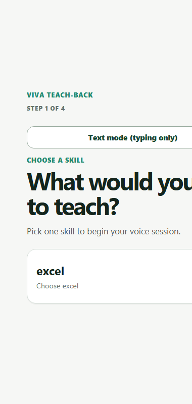
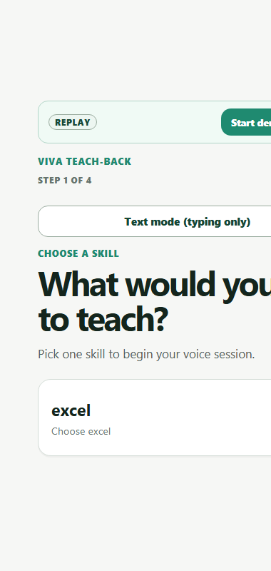
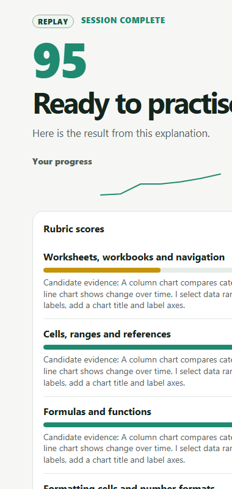
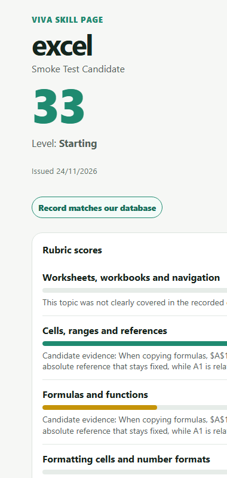
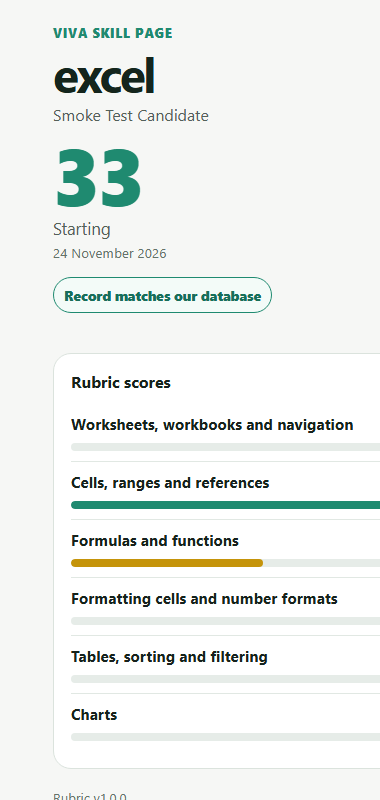
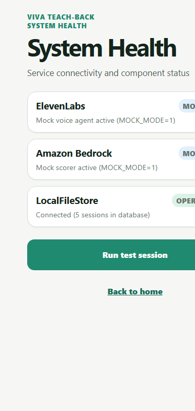
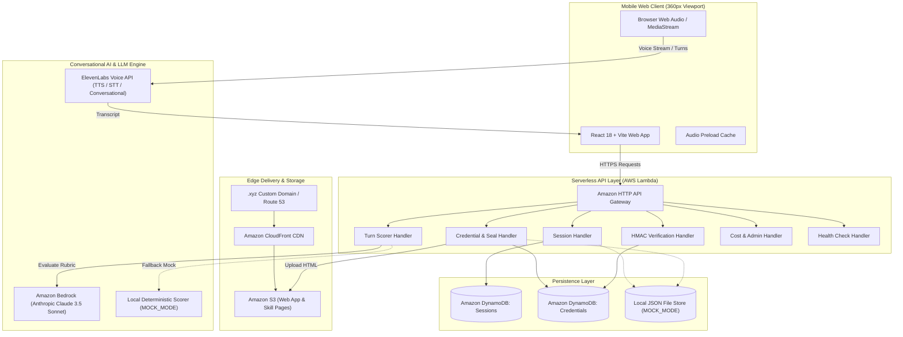
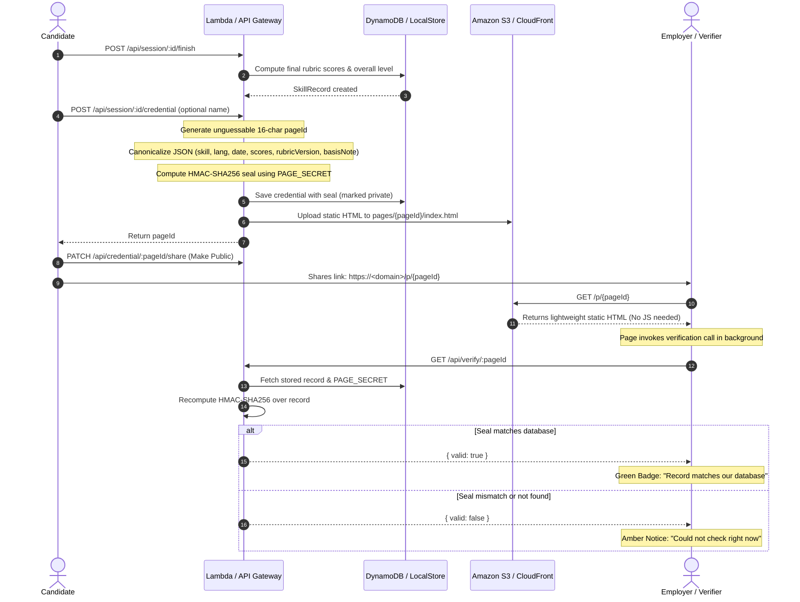

# Prooffolio

> **“Work. Explain. Verify. Learn. Connect.”**  
> An evidence-first, multilingual skill-to-employment platform. It helps learners practise, demonstrate a real task, explain their work to an AI Examiner, cross-verify the evidence, receive a verifiable Skill Passport and discover relevant opportunities.

[](https://www.typescriptlang.org/)
[](https://reactjs.org/)
[](https://vitejs.dev/)
[](https://aws.amazon.com/serverless/sam/)
[](https://elevenlabs.io/)
[](https://aws.amazon.com/bedrock/)

---

## 1. Problem & Core Concept

Millions of informal learners, vocational graduates (ITIs, polytechnics), and non-degree workers across India acquire real-world digital skills through practical experience, YouTube, and peer practice. However, conventional hiring funnels screen them out:
- **Resumes demand English literacy** and self-reported buzzwords that employers cannot trust.
- **Multiple-choice certifications** cost money candidates don't have and test memorisation rather than real application.
- **Interviews are bottlenecked** by human trainer availability and cost.

**Prooffolio flips the dynamic across a 6-stage journey**:
1. **Learn**: Practical micro-lessons for entry-level digital roles.
2. **Practise**: Low-stakes interactive drills in spreadsheets and data tasks.
3. **Demonstrate**: Complete a realistic workplace challenge (e.g., retail sales data cleanup).
4. **Explain (AI Viva)**: An artifact-aware **AI Examiner** interviews the candidate in their native language (English, Hindi, or Kannada) about their actual submitted spreadsheet.
5. **Verify**: Automated cross-verification and issuing of a cryptographically sealed **Skill Passport**.
6. **Connect**: Direct matching to verified local entry-level opportunities.

---

## 2. Visual Walkthrough & Screenshots

Prooffolio is designed **mobile-first for a 360px viewport** with zero passwords, zero typing, and single-tap onboarding.

| 1. Skill Selection & Prooffolio Journey | 2. Demo Replay Safety Banner |
|---|---|
|  |  |
| *Single-tap selection with full journey roadmap and instant fallback to Text Mode.* | *Deterministic `?demo=1` replay mode ensures presentation safety even under complete internet loss.* |

| 3. Live AI Viva Voice Session | 4. Comprehensive Results Screen |
|---|---|
|  |  |
| *Live AI Examiner voice session with speech-to-text transcript and provisional indicator.* | *Deterministic score aggregation, meter trace sparkline, and targeted "Where to improve" feedback.* |

| 5. Sharing & Privacy Controls | 6. Prooffolio Skill Passport |
|---|---|
|  |  |
| *Candidates toggle public visibility, share via native OS share sheet, copy link, or permanently delete.* | *Lightweight static HTML displaying exact badge: "Record matches our database".* |

| 7. System Health & Diagnostics Dashboard |
|---|
|  |
| *Live health dashboard monitoring ElevenLabs voice agent, Bedrock LLM, and local/DynamoDB storage.* |

---

## 3. Architecture Diagrams

### 3.1 End-to-End System & Cloud Architecture

The application is built on a serverless, pay-per-request architecture deployed via AWS SAM:



---

### 3.2 Teach-Back Conversational Loop & Scoring Flow

The interaction is not a question-and-answer quiz. The Student Agent plays the role of a novice, while the backend continuously monitors semantic understanding:

```mermaid
flowchart LR
    A["Candidate Speaks (Kannada / Hindi / English)"] --> B["ElevenLabs Audio Stream & STT"]
    B --> C["Live Transcript Displayed on Screen"]
    C --> D["Turn Captured by Backend"]
    
    subgraph Evaluation["Evaluation & Meter Engine"]
        D --> E["Rubric Criteria Check (Bedrock Claude 3.5 Sonnet)"]
        E --> F["Raw Meter Computation (Weighted Coverage - Penalties)"]
        F --> G["Meter Smoothing (Max 10-pt drop per turn)"]
        G --> H{"Stall Detected?"}
        H -- "No (Progressing)" --> I["Select Next Uncovered Rubric Topic"]
        H -- "Yes (Stuck / Repeating)" --> J["Generate Adaptive Clarification Probe"]
    end

    I --> K["Agent Response Synthesized"]
    J --> K
    K --> L["Audio Cache Check"]
    L -- "Cache Hit (Greeting / Closing)" --> M["Instant Static Audio Playback"]
    L -- "Dynamic Probe" --> N["ElevenLabs Conversational TTS"]
    M --> O["Candidate Hears Beginner Agent"]
    N --> O
```



---

### 3.3 Cryptographic Skill Page Seal & Verification Flow

To prevent tampering without requiring candidate account creation or passwords, Skill Pages are sealed cryptographically:



---

### 3.4 Per-Session Cost Cap & Audio Caching Architecture

Every paid API call is guarded by cost-tracking middleware and a hard financial cap:

```mermaid
flowchart TD
    subgraph CostTracking["Per-Session Cost Tracking & Cap (FR-32, NFR-02)"]
        Start["Session Start"] --> ReadConfig["Read /api/config (COST_CAP_INR = ₹25, USD_INR = 86.5)"]
        ReadConfig --> CalcSec["Calculate maxSeconds = min(600s, Cap / CostPerSecond)"]
        CalcSec --> SessionLoop["Session Active"]
        
        SessionLoop --> TrackUsage["Track ElevenLabs Seconds + Bedrock Tokens"]
        TrackUsage --> UpdateINR["Accumulate INR Total in Session Record"]
        
        UpdateINR --> Check80{"Cost >= 80% or Time >= 80%?"}
        Check80 -- "Yes" --> WarnUI["Frontend Emits Gentle Warning Notice"]
        Check80 -- "No" --> ContinueLoop["Continue Turn"]
        
        WarnUI --> CheckCap{"Cost >= ₹25 or Time >= maxSeconds?"}
        CheckCap -- "Yes" --> GracefulExit["Trigger Graceful Agent Goodbye & Auto-Finish"]
        CheckCap -- "No" --> ContinueLoop
    end

    subgraph AudioCaching["TTS Audio Pre-Caching (FR-33)"]
        GenCache["npm run cache:audio / generateAudioCache.ts"] --> PreTTS["Pre-generate Fixed Lines via ElevenLabs"]
        PreTTS --> S3Audio["Save to S3 /public/audio/ (en, hi, kn greetings & closings)"]
        S3Audio --> ServeCache["Zero Token Cost: Played directly from CDN"]
    end
```



---

## 4. Key Engineering Highlights

- **Mobile-First (360px Viewport)**: Tested and optimized for entry-level Android devices. Large tap cards, zero typing, high-contrast typography.
- **Multilingual Support**: First-class support for English (`en`), Hindi (`hi`), and Kannada (`kn`). Adding a language requires only translating the rubric JSON and voice configuration.
- **Understanding Meter Engine**: A non-linear algorithm that rewards concrete evidence (cell coordinates, function syntax), severely suppresses jargon and buzzwords, smooths downward drops (max 10 pts per turn), and flags conversational stalling.
- **Anti-Bluff Verification Harness (NFR-05)**: Rigorously tested with 10 scripted genuine candidates and 10 scripted bluffers. Achieves a **63.2-point score gap** (exceeding the $\ge 25$-point threshold) and 100% group separability.
- **Early Reviewer Check Tooling**: `npm run reviewer:export` and `npm run reviewer:compare` allow human subject-matter reviewers to grade candidate transcripts independently and report mean absolute score spread.
- **Demo Safety Fallbacks (FR-34)**:
  - `?demo=1` flag: Replays recorded sessions with deterministic timings and meter trace if network fails.
  - **Text Mode**: Complete typing-only fallback accessible from the very first screen.
  - `/health` dashboard: Real-time service ping for ElevenLabs, Bedrock, and storage.
  - **Global Error Boundary**: Friendly retry screen preventing unhandled UI crashes.

---

## 5. Quick Start & Local Development

The entire application runs locally with zero AWS or ElevenLabs keys using `MOCK_MODE=1`.

### Prerequisites
- Node.js 20 or newer
- npm 10 or newer

### Installation

```powershell
# 1. Clone the repository
git clone https://github.com/AnanthAkshay/Whackiest_2k26.git
cd Whackiest_2k26

# 2. Copy the environment template
Copy-Item .env.example .env

# 3. Install dependencies
npm install

# 4. Start local development servers (API on 8787, Web on 5173)
npm run dev
```

Visit [http://localhost:5173](http://localhost:5173) on your browser (or open Chrome DevTools in Mobile 360px mode).

---

## 6. Verification & Test Commands

```powershell
# Run TypeScript compilation checks across all workspaces
npm run typecheck

# Run unit and integration tests (Rubric, Meter, Store, Prompts)
npm test

# Run the 20-transcript Anti-Bluff harness (genuine vs bluffer separation)
npm run test:bluff

# Export finished sessions to CSV for human reviewer grading
npm run reviewer:export

# Compare human reviewer scores against AI scores and generate report
npm run reviewer:compare

# Run end-to-end deployment smoke test
npm run smoke -- http://localhost:8787
```

---

## 7. Repository Layout

```
Whackiest_2k26/
├── api/                    # Serverless backend (Node.js + TypeScript)
│   ├── src/
│   │   ├── handlers/       # Lambda HTTP handlers (sessions, credentials, verify, admin, health)
│   │   ├── scorer/         # BedrockScorer (Claude 3.5 Sonnet) & MockScorer
│   │   ├── services/       # HMAC-SHA256 seal, static HTML generator, audio cache
│   │   ├── store/          # DynamoStore & LocalFileStore
│   │   ├── voice/          # ElevenLabs agent adapter & prompt templates
│   │   ├── meter.ts        # Understanding Meter smoothing & stall detection
│   │   └── pricing.ts      # Real-time INR token & duration cost tracking
│   └── fixtures/           # Benchmark candidate transcripts
├── web/                    # Frontend client (React 18 + Vite + TypeScript)
│   ├── src/
│   │   ├── setup/          # Single-tap 4-step onboarding (Skill, Lang, Level, Consent)
│   │   ├── session/        # Live conversation UI, MeterBar, transcript bubble
│   │   ├── results/        # Candidate score breakdown & improve recommendations
│   │   ├── skill/          # Skill Page viewing & native sharing
│   │   ├── health/         # System diagnostic dashboard
│   │   └── i18n/           # English, Hindi, and Kannada translation files
├── rubrics/                # Versioned public-source skill rubrics
│   ├── excel.json          # Microsoft Excel Basic (MO-200 aligned)
│   └── sources/            # Reference documentation and MO-200 mappings
├── infra/                  # AWS SAM infrastructure
│   ├── template.yaml       # DynamoDB, Lambda, S3, CloudFront, HTTP API
│   └── README.md           # Deployment runbook
├── tests/                  # Verification and QA harnesses
│   ├── bluff/              # 20 scripted bluff transcripts & harness runner
│   └── reviewer/           # Human reviewer export & comparison tooling
├── docs/                   # Engineering documentation
│   ├── assets/screenshots/ # High-resolution UI walkthrough screenshots
│   ├── DEMO-SCRIPT.md      # Exact 3-minute pitch & live demo script
│   └── cost.md             # Unit economics & cost tracking analysis
├── scripts/                # Deployment, smoke test, and screenshot automation
├── DEPLOY.md               # Step-by-step production deployment checklist
└── AGENTS.md               # Repository rules & honesty guidelines
```

---

## 8. Honesty & Ethical AI Disclosure

- **Rubric Source**: The Microsoft Excel rubric is built from public educational sources (Microsoft's MO-200 skills outline and Microsoft Support help pages). It is not an official Microsoft certification.
- **Verification Grounding**: On a Skill Page, the badge reads strictly: `"Record matches our database"`. It confirms tamper-evident record integrity against our store and does not claim accredited human trainer certification.
- **Pilot Co-Sign Plan**: Formal trainer co-signing and the 80% human agreement separation evaluation are scheduled for the pilot phase with polytechnic and ITI partners.

---

## 9. Team — The North Remembers

Department of Computer Science and Engineering  
**M S Ramaiah Institute of Technology, Bangalore**  
*Track 04: UnlockED · Online Ideathon 2026*

- **Akshay A** (Lead) — `1MS24IS013`
- **Abhishek** — `1MS24CS006`
- **Abhishek Rakesh Hegde** — `1MS24IS003`
- **Ankush Kumar Doddamani** — `1MS24IS024`
