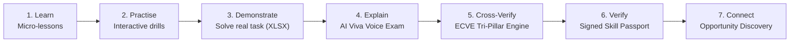
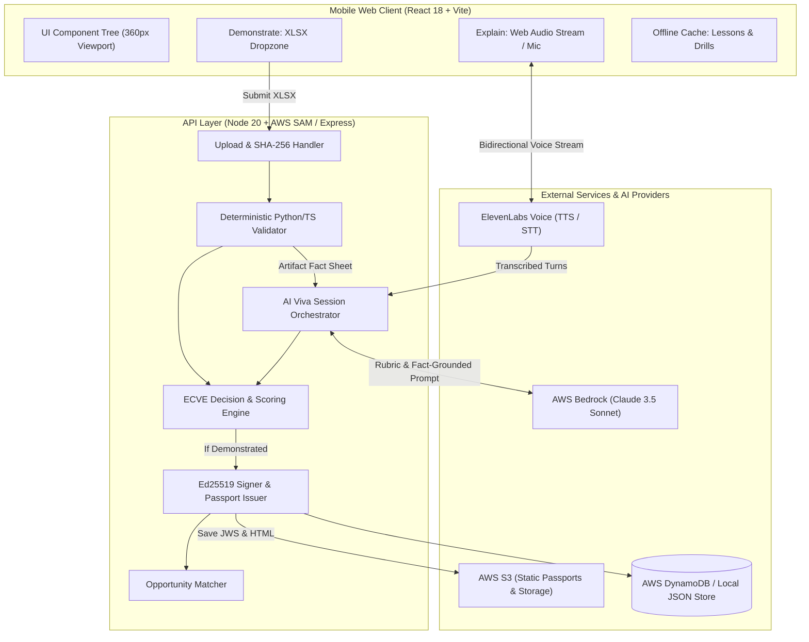

# Prooffolio: Software Requirements Specification (SRS)

> **Document Version**: 2.0.0  
> **Date**: 25 November 2026  
> **Event**: wHACKiest 2026 · Track 04 (UnlockED)  
> **Product Name**: Prooffolio (strictly Prooffolio; not "Prooffolio 2.0" and not "Viva Teach-Back")  
> **Tagline**: *“Work. Explain. Verify. Learn. Connect.”*

---

## 1. Introduction

Prooffolio is an evidence-first, multilingual skill-to-employment web platform that empowers vocational students, non-degree job seekers, and informal learners to prove practical competency. Instead of relying on self-reported resumes or multiple-choice exams, candidates **demonstrate** real-world digital tasks, **explain** their reasoning to an artifact-aware AI Examiner, undergo automated **cross-verification**, receive a tamper-evident cryptographic **Skill Passport**, and **connect** directly to entry-level employment opportunities.

### 1.1 Purpose
This SRS establishes the authoritative specification for Prooffolio for wHACKiest 2026 Track 04 (UnlockED) and subsequent pilot deployments. It defines user journeys, functional requirements (FRs), non-functional requirements (NFRs), data schemas, and architectural boundaries.

### 1.2 End-to-End Product Journey
The user experience flows across seven cohesive stages:
1. **Learn**: Practical micro-lessons and job-role expectations.
2. **Practise**: Low-stakes interactive drills and exercises (including optional tryb link-outs).
3. **Demonstrate**: Hands-on challenge execution with raw data and submission of a completed artifact (primary: XLSX).
4. **Explain**: Conversational voice interview with the **AI Examiner** (the **AI Viva**), probing the candidate's exact work.
5. **Cross-Verify**: Deterministic consistency check between viva explanations and artifact facts.
6. **Verify**: Issuance and public verification of an Ed25519-signed **Skill Passport** bound to the file's SHA-256 fingerprint.
7. **Connect**: Transparent matching to relevant local entry-level opportunities.



### 1.3 Scope
- **In-Scope MVP**:
  - **Target Role**: Entry-Level Data Entry Operator.
  - **Target Challenge**: Retail Sales Cleanup & Reporting.
  - **Accepted Formats**: `.xlsx` as primary accepted file format (CSV supported only if safely validated and tested).
  - **Deterministic Validator**: Python/TypeScript code evaluating objective rules to produce a structured fact sheet.
  - **AI Viva**: Multilingual voice interview (English, Hindi, Kannada) powered by ElevenLabs voice streaming and Bedrock orchestration.
  - **ECVE Scoring**: Tri-pillar composite scoring ($P=60\%, U=25\%, C=15\%$).
  - **Decision Engine**: 4 outcomes (*Not yet demonstrated*, *Partially demonstrated*, *Demonstrated*, *Pending Human Review*).
  - **Skill Passport**: Ed25519-signed JWS with SHA-256 artifact binding, hosted statically with minimal consented metadata.
  - **Opportunity Matching**: Algorithmic fit score with transparent breakdown and sample local listings.
  - **Resilience**: Full local execution via `MOCK_MODE=1`, `?demo=1` deterministic replay, and text-mode fallback.
- **Planned / Post-MVP**:
  - Employer portal with bulk candidate search and active hiring pipelines.
  - Advanced multi-format ingestion (complex database dumps, PDF forms).
  - Formal peer-tutoring marketplace.

### 1.4 Terminology & Definitions

| Term | Definition |
|---|---|
| **Candidate / Learner** | A job-seeker demonstrating vocational competency without needing a formal degree. |
| **AI Viva / AI Examiner** | The voice-based examination feature inside Prooffolio where an AI interviewer queries the candidate on their artifact. |
| **Artifact Fact Sheet** | A deterministic JSON structure extracted from the candidate's submitted spreadsheet (cell formulas, row counts, cleaning operations). |
| **ECVE** | **Execution, Comprehension, Verification, Evidence**: The multi-dimensional assessment framework. |
| **Provisional Indicator** | Real-time conversational feedback meter shown during the viva; does not prematurely decide final pass/fail. |
| **Skill Passport** | A tamper-evident digital credential containing role, competency outcomes, artifact SHA-256 hash, and an Ed25519 digital signature. |
| **Review Signal** | A discrepancy between spoken explanation and file facts that routes an attempt to human review without alleging cheating. |
| **Verifier** | An employer, hiring manager, or partner platform validating a Skill Passport. |

---

## 2. Overall System Description

### 2.1 Problem & Value Proposition
Conventional hiring channels fail vocational candidates:
1. **Resumes exclude non-English speakers** and reward buzzword stuffing over real capability.
2. **Multiple-choice certifications** test rote memorization rather than hands-on job execution.
3. **Manual technical interviews** are cost-prohibitive for high-volume entry-level roles.

Prooffolio bridges this divide: candidates submit actual work artifacts, speak naturally in their native tongue, and receive an independently verifiable credential that employers can trust without trusting the candidate's word alone.

### 2.2 User Classes & Personas
- **Candidate (Vocational Learner)**: Focuses on quick onboarding, mobile phone compatibility, zero password friction, native language options (en, hi, kn), and clear skill feedback.
- **Employer / Verifier**: Seeks instantaneous verification, proof that claims match actual file output, and transparent skill breakdown.
- **Reviewer / Auditor**: Inspects flagged attempts (Pending Human Review) to resolve discrepancies fairly.

### 2.3 Sponsor Ecosystem Roles & Operational Boundaries
Prooffolio integrates distinct sponsor services with strict architectural separation:

| Sponsor / Service | Architectural Role | Operational Reality & Guardrails |
|---|---|---|
| **ElevenLabs** | Voice Layer (Conversational AI, TTS, STT) | Supplies low-latency audio streaming. Application backend maintains question control and scoring. |
| **AWS** | Serverless Cloud Infrastructure | Lambda, DynamoDB, S3, CloudFront, and Bedrock (Claude 3.5 Sonnet). *Note: AWS Student Builder Group is a community sponsor, not a cloud runtime.* |
| **.xyz Domain** | Custom Passport Hostname | Serves static, minimal Skill Passports at `https://<domain>/passport/{id}` upon domain registration. |
| **tryb** | External Practice Game | Optional link-out to gamified typing/data drills in the *Practise* stage. |
| **Devnovate** | Portfolio & Opportunity Link-Outs | Partner link-out for extended portfolio profiles and partner job feeds in the *Connect* stage. |

> [!IMPORTANT]
> **No Assumed Secrets**: All sponsor integrations activate **only** when corresponding environment variables are explicitly configured. In their absence, `MOCK_MODE=1` provides a 100% complete, free local baseline.

---

## 3. Functional Requirements

### 3.1 Onboarding & Setup (Stage 1 & 2: Learn & Practise)
- **FR-01 (Zero Login)**: The system shall permit candidates to begin by providing only a handle/name and optional contact (phone or email); no password creation or typing required in main flow.
- **FR-02 (Role & Challenge Selection)**: The system shall default to the MVP role: *Entry-Level Data Entry Operator* and challenge: *Retail Sales Cleanup & Reporting*.
- **FR-03 (Multilingual Support)**: The system shall provide full UI and audio localization in English (`en`), Hindi (`hi`), and Kannada (`kn`).
- **FR-04 (Micro-Lessons & Drills)**: The system shall present core expectations (data hygiene, date formats, formula usage) and optional practice drill links (including tryb).
- **FR-05 (Audio & Device Permissions)**: The system shall test microphone permissions and provide clear, non-blocking fallback instructions if blocked.

### 3.2 Workplace Demonstration (Stage 3: Demonstrate)
- **FR-06 (Starter Dataset Download)**: The system shall provide the uncleaned challenge file (`retail_sales_messy.xlsx`).
- **FR-07 (Artifact Upload Dropzone)**: The system shall accept the candidate's cleaned `.xlsx` file via single-tap file upload or drag-and-drop.
- **FR-08 (SHA-256 Fingerprinting)**: The system shall immediately calculate and store a SHA-256 checksum of the submitted file upon receipt.
- **FR-09 (Deterministic Validation)**: The backend shall execute a deterministic spreadsheet validator (Python/code-based) against the uploaded file, checking:
  1. Header normalization and column structure.
  2. Whitespace trimming and name title-casing.
  3. Date standardization to ISO `YYYY-MM-DD`.
  4. Missing value handling and imputation rules.
  5. Accurate formula calculation for totals, averages, and counts (`=SUM`, `=AVERAGE`, `=COUNTIF`).
- **FR-10 (Artifact Fact Sheet Generation)**: The validator shall output a structured JSON Fact Sheet summarizing exact objective achievements and cell locations.

### 3.3 Artifact-Grounded AI Viva (Stage 4: Explain)
- **FR-11 (Grounded Questioning)**: The AI Examiner shall generate spoken questions grounded directly in the versioned challenge rubric and the candidate's Artifact Fact Sheet (e.g., querying specific formulas used in row 12 or cell F45).
- **FR-12 (Backend Question Selection)**: Application-controlled backend logic and Bedrock shall select viva topics; ElevenLabs shall function as the audio input/output streaming layer.
- **FR-13 (Live Transcript Streaming)**: The system shall display a real-time transcript of both the examiner's prompts and candidate's spoken responses.
- **FR-14 (Provisional Indicator)**: The system shall compute a conversational provisional indicator (0–100) reflecting dialogue flow without making a premature pass/fail decision.

### 3.4 Cross-Verification & ECVE Assessment (Stage 5: Cross-Verify)
- **FR-15 (ECVE Multi-Dimensional Model)**: The assessment engine shall evaluate candidates across three normalized pillars:
  - **Practical Execution ($P$)** = 60%: Derived from the deterministic validator score.
  - **Conceptual Understanding ($U$)** = 25%: Derived from AI Viva rubric criteria coverage.
  - **Evidence Consistency ($C$)** = 15%: Derived from cross-verifying candidate statements against file facts.
  - **Composite Formula**:
    $$\text{Composite Score} = 0.60P + 0.25U + 0.15C$$
  *(Note: Weights are proposed design values subject to pilot calibration; they do not represent measured statistical accuracy).*
- **FR-16 (Outcome Decision Matrix)**: The engine shall assign one of four authoritative outcomes:
  1. **Not yet demonstrated**: Composite $< 40$ or unassessable.
  2. **Partially demonstrated**: $40 \le \text{Composite} < 75$, or $\ge 75$ with any critical criterion failed.
  3. **Demonstrated**: Composite $\ge 75$, all critical criteria passed, minimum evidence satisfied, and no unresolved high-risk conflicts.
  4. **Pending Human Review**: Triggered when an unresolved mismatch occurs, transcript confidence is low, evidence is ambiguous, or a technical fault is recorded.
- **FR-17 (Review Signal Handling)**: A mismatch between spoken explanation and file facts shall be logged as an audit review signal, **never** as proof of cheating or deliberate fraud.
- **FR-18 (Credential Restriction)**: The system shall issue a signed Skill Passport **only** for authoritative *Demonstrated* outcomes.

### 3.5 Skill Passport & Verification (Stage 6: Verify)
- **FR-19 (Ed25519 JWS Credential)**: The backend shall issue a cryptographically signed JSON Web Signature (JWS) using an Ed25519 keypair, embedding the candidate handle, role, challenge ID, ECVE scores, timestamp, and artifact SHA-256 hash.
- **FR-20 (Tamper-Evident Public Page)**: The system shall serve a lightweight static HTML Skill Passport (`/passport/{pageId}` or `/p/{pageId}`).
- **FR-21 (Privacy by Default)**: Public Skill Passport pages shall display only minimal, consented data. Raw audio, full viva transcripts, and raw uploaded spreadsheets shall remain strictly private.
- **FR-22 (Verification Badge & Endpoint)**: The passport page shall display the exact wording: `"Record matches our database"`. A public endpoint (`GET /api/verify/{pageId}`) shall verify cryptographic validity and database match.

### 3.6 Opportunity Discovery & Matching (Stage 7: Connect)
- **FR-23 (Demonstrated-Only Matching)**: Opportunity matching shall consider **only** active skills with a *Demonstrated* outcome.
- **FR-24 (Weighted Match Algorithm)**:
  $$\text{Match Percentage} = \frac{\sum (\text{weight}_i \times \text{matched}_i)}{\sum \text{weight}_i} \times 100$$
- **FR-25 (Explainable Recommendations)**: Each opportunity card must clearly display matched criteria, missing gaps, criteria weights, posting date, listing source, and sample vs. live status.
- **FR-26 (Human Agency Guardrail)**: The system shall never automatically apply for a candidate and shall never automatically reject a candidate from a job feed.
- **FR-27 (Partner Link-Outs)**: The system shall support external portfolio link-outs to Devnovate.

### 3.7 Resilience, Health & Offline Support
- **FR-28 (Local MOCK_MODE)**: With `MOCK_MODE=1`, the entire 7-stage flow must run locally without AWS credentials or ElevenLabs API keys, using local JSON file storage, a deterministic mock scorer, and simulated voice audio.
- **FR-29 (Demo Replay Mode)**: Appending `?demo=1` shall replay a deterministic recorded session from `/demo/session.json` with a subtle visual replay label.
- **FR-30 (Text Mode Fallback)**: The UI shall provide a prominent "Text mode" option on the initial screen to allow completion via typing if speech or audio fails.
- **FR-31 (Health Dashboard)**: The system shall provide a `/health` dashboard showing live diagnostics for ElevenLabs, Bedrock, and storage systems with a one-click test session runner.
- **FR-32 (Offline Capability)**: The client shall cache micro-lessons, challenge instructions, and practice drills for offline study. Viva audio streaming, cloud validation, credential signing, and public verification require active internet connectivity.

---

## 4. Non-Functional Requirements (NFRs)

| ID | Category | Requirement Description |
|---|---|---|
| **NFR-01** | **Mobile-First UX** | The entire interface must be optimized for a 360px viewport width, maintaining touch targets $\ge 44\text{px}$ and high contrast. |
| **NFR-02** | **Voice Turn Latency** | In live voice mode, response audio should begin within 1.5–2.0 seconds of speech termination under typical 4G network conditions. |
| **NFR-03** | **Deterministic Integrity** | All objective spreadsheet checks must be executed by deterministic code (Python/TS); LLMs must never be used to guess formula syntax or numeric calculations. |
| **NFR-04** | **Tamper Evidence** | Credentials must use Ed25519 JWS signatures binding the candidate handle and ECVE scores to the artifact SHA-256 fingerprint. |
| **NFR-05** | **Bluff Resistance** | The assessment engine must discriminate between rehearsed jargon and genuine understanding; bluffing candidates must score below 40 on comprehension. |
| **NFR-06** | **Privacy & Data Minimization** | Raw audio must never be permanently stored. Transcripts are retained only with candidate consent and are immediately purgeable upon candidate request. |
| **NFR-07** | **Honesty & Disclosures** | The system must never claim "trainer-verified", "officially certified", "cheat-proof", or cite uncalibrated agreement figures. Rubric sources must be disclosed. |
| **NFR-08** | **Zero Secret Leaks** | No environment variables containing secrets may be committed. All variables must be documented in `.env.example`. |
| **NFR-09** | **Cost & Quota Safety** | Voice sessions must enforce strict turn limits ($\le 6$ candidate turns) and question timeouts to prevent uncontrolled API cost. |
| **NFR-10** | **Graceful Degradation** | Complete network or API outage on external providers must trigger automatic, polite fallbacks without dropping candidate state. |

---

## 5. System Architecture & Data Flows

### 5.1 Architecture Overview



---

## 6. Data Models & Schemas

### 6.1 Artifact Fact Sheet Schema
```json
{
  "artifactSha256": "e3b0c44298fc1c149afbf4c8996fb92427ae41e4649b934ca495991b7852b855",
  "fileName": "retail_sales_messy.xlsx",
  "fileSizeBytes": 45120,
  "parsedAt": "2026-11-25T00:15:00.000Z",
  "objectiveChecks": {
    "whitespaceTrimmed": true,
    "datesStandardized": true,
    "missingValuesHandled": true,
    "totalSalesFormula": "=SUM(F2:F101)",
    "averageSalesFormula": "=AVERAGE(F2:F101)",
    "categoryCountsFormula": "=COUNTIF(C2:C101, \"Electronics\")"
  },
  "executionScore": 88.5
}
```

### 6.2 ECVE Assessment Record Schema
```json
{
  "attemptId": "att_9f82c1",
  "candidateId": "cand_usr_01",
  "roleId": "data_entry_operator",
  "challengeId": "retail_sales_cleanup",
  "evaluatedAt": "2026-11-25T00:16:30.000Z",
  "dimensions": {
    "practicalExecution": 88.5,
    "conceptualUnderstanding": 80.0,
    "evidenceConsistency": 90.0
  },
  "compositeScore": 86.6,
  "weights": { "P": 0.60, "U": 0.25, "C": 0.15 },
  "outcome": "Demonstrated",
  "criticalCriteriaPassed": true,
  "reviewFlags": []
}
```

### 6.3 Skill Passport JWS Payload
```json
{
  "iss": "https://prooffolio.xyz",
  "sub": "cand_usr_01",
  "iat": 1795565800,
  "passportId": "pass_e7d2a1",
  "role": "Entry-Level Data Entry Operator",
  "challenge": "Retail Sales Cleanup & Reporting",
  "ecve": {
    "execution": 88.5,
    "understanding": 80.0,
    "consistency": 90.0,
    "composite": 86.6
  },
  "outcome": "Demonstrated",
  "artifactSha256": "e3b0c44298fc1c149afbf4c8996fb92427ae41e4649b934ca495991b7852b855",
  "rubricBasis": "Rubric built from public sources (Microsoft MO-200 skills outline). Trainer co-sign planned in the pilot."
}
```

---

## 7. Honesty, Disclosures & Pilot Roadmap

1. **Rubric Sourcing**: The retail data cleanup rubric is synthesized from public vocational guidelines (including Microsoft MO-200 skills outline and Microsoft Support documentation). It does not represent an accredited certification.
2. **Trainer Co-Sign**: A formal trainer co-signing process and statistical inter-rater agreement study ($>80\%$ target) are scheduled for the Phase 2 vocational pilot.
3. **Authorship Truth**: Cryptographic hash binding confirms that the credential refers to a specific digital artifact. It does not establish biological human authorship; the AI Viva interview provides the behavioral corroboration layer.
