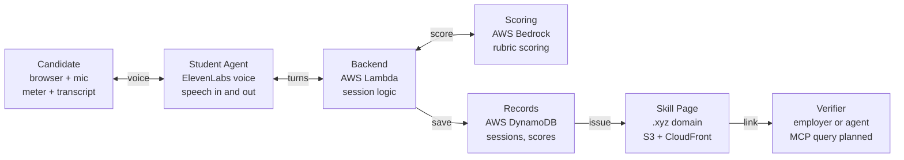

# Viva Teach-Back: Software Requirements Specification

wHACKiest 2026 · Track 04 (UnlockED) · 22 Nov 2026

## 1. Introduction

Viva Teach-Back is a free, voice-based platform that verifies a person's skill by having them teach it to an AI "confused beginner", and issues a shareable, machine-checkable skill page. This document defines what the hackathon MVP must do and what is planned after it.

### 1.1 Purpose

This SRS gives the team, mentors and judges one agreed description of the product: who it serves, what it does, and how we will know it works. It targets Track 04 (UnlockED) of wHACKiest 2026, an online ideathon on 26 to 27 November 2026.

### 1.2 Scope

- **In scope (MVP):** one skill (Excel), one or two languages, the voice Teach-Back session, rubric-based scoring, a skill page on a .xyz domain.
- **Planned, shown as mockup or thin demo:** the MCP verification endpoint, the peer-tutor marketplace, employer search.
- **Out of scope:** government-grade certification, payments, video proctoring, job application workflows.

### 1.3 Definitions

| Term | Meaning |
| --- | --- |
| Candidate | A person proving a skill, usually without a degree or certificate |
| Student Agent | The AI "confused beginner" the candidate teaches, voiced through ElevenLabs |
| Teach-Back session | A spoken session of about 10 minutes in which the candidate explains a skill to the Student Agent |
| Understanding Meter | A live score showing how well the Student Agent has understood the explanation |
| Skill Page | A public page per verified skill, hosted on a .xyz domain |
| Verifier | An employer or hiring system that checks a Skill Page |
| Rubric | Fixed scoring criteria for one skill, stored as a file, built from public sources and co-signed by a trainer in the pilot |
| MCP | Model Context Protocol, used here so an AI agent can query a candidate's verified skill |

### 1.4 References

- wHACKiest 2026 organizer template and Track 04 (UnlockED) brief
- Sponsor documentation: ElevenLabs, AWS, .xyz (tryb to be confirmed)

## 2. Overall description

Viva is a standalone web product that sits between learners and employers: it turns spoken explanation into a verified, shareable skill record, free for the candidate.

### 2.1 Problem and need

Skilled people in underserved communities often cannot get hired because they lack a degree or certificate. Written tests and English-only resumes exclude them, and employers cannot tell real skill from bluffing. Viva tests the person directly, in their own language, by speech.

*(Open item: add one sourced statistic, for example from the India Skills Report or NSDC data.)*

### 2.2 User classes

| User | Goal | Needs |
| --- | --- | --- |
| Candidate | Prove a skill and share the proof | Free, voice-first, own language, works on a phone |
| Verifier (employer) | Trust a claimed skill quickly | A link or agent query that confirms level and date |
| Peer tutor (planned) | Earn by teaching beginners | A verified skill and a way to be matched |
| Admin (team) | Keep rubrics and question banks correct | Rubric editor, session logs |

### 2.3 Product functions in brief

1. Candidate chooses a skill and language.
2. A Student Agent asks to be taught, in voice.
3. The Understanding Meter rises or stalls as the candidate explains.
4. A scorer grades the session per sub-skill against the rubric.
5. The candidate receives a Skill Page on a .xyz domain.
6. Verifiers open the page, or query it through an MCP endpoint.

### 2.4 Assumptions and dependencies

- Candidates have a smartphone or laptop with a microphone and a basic internet connection.
- ElevenLabs voice and speech services are available through sponsor credits or a free tier.
- AWS services run within student credits or free-tier limits at demo scale.
- A .xyz domain is available through the sponsor, or bought once and used with subdomains.

### 2.5 Constraints

- Build window of about 24 hours, so a single skill and one or two languages.
- Zero budget: all paid calls are capped per session and cached where possible.
- The credential is a first-pass screen, not an accredited certificate.
- The MVP Excel rubric is built from public sources (Microsoft MO-200 skills outline and Microsoft Support help pages). A trainer co-sign is sought for the pilot.

## 3. Functional requirements

The system shall meet 22 functional requirements in five modules; 17 are MVP and 5 are planned.

### 3.1 Onboarding and session setup

| ID | Requirement | Priority |
| --- | --- | --- |
| FR-1 | The system shall let a candidate start without creating a password, using a name and a phone or email. | MVP |
| FR-2 | The system shall let the candidate choose a skill from the available list. | MVP |
| FR-3 | The system shall let the candidate choose the session language. | MVP |
| FR-4 | The system shall check microphone access and show a clear error if it is blocked. | MVP |
| FR-5 | The system shall show a short consent notice before recording starts. | MVP |

### 3.2 Teach-Back voice session

| ID | Requirement | Priority |
| --- | --- | --- |
| FR-6 | The Student Agent shall open the session by asking the candidate to teach a specific topic from the skill's rubric. | MVP |
| FR-7 | The system shall carry on a spoken conversation in the chosen language, with natural turn-taking and interruption. | MVP |
| FR-8 | The Student Agent shall ask follow-up questions when an explanation is unclear, skips a step or is incorrect. | MVP |
| FR-9 | The system shall cover each rubric sub-skill by moving to a new topic once one is understood or after a set number of attempts. | MVP |
| FR-10 | The session shall end after the topics are covered or a time limit of about 10 minutes, whichever is first. | MVP |
| FR-11 | The system shall show a live transcript so the candidate can see what was heard. | MVP |

### 3.3 Understanding Meter and scoring

| ID | Requirement | Priority |
| --- | --- | --- |
| FR-12 | The system shall update the Understanding Meter after each candidate turn. | MVP |
| FR-13 | The scorer shall grade each sub-skill against the fixed rubric and return a score and a one-line reason. | MVP |
| FR-14 | The system shall compute an overall level from the sub-skill scores. | MVP |
| FR-15 | The system shall show the candidate a results screen with scores and where to improve. | Planned |

### 3.4 Skill Page and credential

| ID | Requirement | Priority |
| --- | --- | --- |
| FR-16 | On passing a level, the system shall create a public Skill Page showing skill, level, sub-skill scores and date. | MVP |
| FR-17 | The Skill Page shall be served on a .xyz domain with a unique, readable address. | MVP |
| FR-18 | The candidate shall be able to copy and share the page link. | MVP |
| FR-19 | The Skill Page shall expose a machine-readable verification endpoint using MCP so a Verifier's agent can confirm level and date. | Planned |

### 3.5 Marketplace (planned)

| ID | Requirement | Priority |
| --- | --- | --- |
| FR-20 | Verified candidates shall be able to opt in as peer tutors for beginners in their skill. | Planned |
| FR-21 | Verifiers shall be able to search verified candidates by skill and level. | Planned |
| FR-22 | The system shall log verification queries so a candidate can see who checked their page. | Planned |

## 4. Non-functional requirements

Targets below are proposed and should be confirmed in testing.

| ID | Area | Requirement |
| --- | --- | --- |
| NFR-1 | Latency | The Student Agent shall begin replying within about 1.5 seconds of the candidate finishing a sentence. |
| NFR-2 | Languages | The MVP shall support English plus one Indian language; adding a language shall need only a rubric translation and a voice choice. |
| NFR-3 | Accessibility | The interface shall work with large text, high contrast and a phone-sized screen, and every spoken prompt shall also appear as text. |
| NFR-4 | Low bandwidth | A session shall run on a typical mobile connection; the page shall be light and shall recover if the connection drops. |
| NFR-5 | Privacy | Audio shall not be stored by default; transcripts shall be kept only with consent and deletable on request. |
| NFR-6 | Security | Skill Page records shall be tamper-evident, and only the system shall be able to create or change a verified result. |
| NFR-7 | Fairness | Scoring shall be based on the rubric, not on accent or speaking speed, and the transcript shall be shown to the candidate. |
| NFR-8 | Cost | Each session shall stay within a per-session cap on voice minutes and model calls, with question audio cached and reused. |
| NFR-9 | Reliability | If a paid service fails, the session shall fall back to text input rather than ending. |
| NFR-10 | Maintainability | A new skill shall be added by writing a rubric file, with no change to application code. |

### 4.5 Pilot scope note

FR-25 is a Pilot item and is not part of the MVP.

## 5. External interfaces

### 5.1 Sponsor and service interfaces

| Interface | Used for | Requirements it serves |
| --- | --- | --- |
| ElevenLabs (voice agent, text-to-speech, speech-to-text) | The Student Agent's voice, understanding the candidate's speech, multilingual conversation | FR-6, FR-7, FR-8, FR-11, NFR-1, NFR-2 |
| AWS (Bedrock, Lambda, DynamoDB, S3, CloudFront) | Rubric scoring and follow-up generation, backend logic, session and credential storage, Skill Page hosting | FR-9, FR-13, FR-14, FR-16, NFR-6, NFR-8 |
| .xyz domain | Public address of each Skill Page | FR-17, FR-18 |
| tryb | To be decided once the sponsor's offering is confirmed | n/a |

### 5.2 Interface provided by Viva

- **User interface:** a responsive web app with a start screen, a live session screen (transcript and Understanding Meter), a results screen and the public Skill Page.
- **Verification endpoint (planned):** an MCP server that lets a Verifier's agent ask for a candidate's skill, level and date and receive a signed answer (FR-19).

### 5.3 Hardware and software

- Candidate device: any modern browser with microphone access.
- Network: a standard mobile data connection.
- No special hardware is required.

## 6. System architecture and data flow

Text version: Candidate ↔ Student Agent (voice) ↔ Backend (turns) ↔ Scoring (score). Backend → Records (save) → Skill Page (issue) → Verifier (link; MCP query planned).

The top row is the live session: the candidate speaks to the Student Agent, the backend runs the conversation and sends answers to Bedrock for scoring. The bottom row is the result: the backend saves scores, a Skill Page is issued on the .xyz domain, and a Verifier opens its link.

## 7. Data requirements

Viva stores six kinds of records, and keeps as little personal data as it can: no audio by default and no password.

| Entity | Key fields | Notes |
| --- | --- | --- |
| Candidate | id, name, contact, language, created date | Contact used only to return to a session or Skill Page |
| Rubric | skill, sub-skills, scoring criteria, question bank, version | Written as a file per skill (NFR-10); version is saved with every score |
| Session | id, candidate, skill, language, start and end time, status | One per Teach-Back attempt |
| Transcript turn | session, speaker, text, time | Stored only with consent; deletable on request (NFR-5) |
| Score | session, sub-skill, score, one-line reason, overall level | Kept with the rubric version used |
| Skill Page | address, candidate, skill, level, scores, issue date, signature | Public; the signature supports tamper checks (NFR-6) |

### 7.1 Retention and deletion

- Audio is processed live and discarded.
- Transcripts are deleted on request, and by default after a short review window to be decided.
- A candidate can unpublish their Skill Page at any time.

### 7.2 Verification log (planned)

Each query to the verification endpoint records the time and the Verifier's identity or key, so the candidate can see who checked their page (FR-22).

## 8. MVP scope, risks and acceptance

The MVP is done when one candidate can teach Excel by voice, watch the Understanding Meter move, and receive a working Skill Page on a .xyz address. Everything else is shown as a mockup.

### 8.1 Risks and responses

| Risk | Effect | Response |
| --- | --- | --- |
| Bluffing or rehearsed answers | Weak trust in the credential | Adaptive follow-ups (FR-8); state that this is a first-pass screen, not an accredited certificate |
| Inconsistent grading | Unfair or unstable scores | Fixed rubrics built from public sources; trainer check in the pilot, one short scoring call per answer, rubric version saved with each score |
| Speech recognition errors on accents | Candidate marked down unfairly | Show the live transcript (FR-11), score on meaning rather than exact words, allow a re-attempt |
| Voice service cost or limits | Demo stalls | Cache question audio, cap session length (NFR-8), fall back to text (NFR-9) |
| Scope too large for the time | Unfinished demo | One skill, one or two languages, mock the marketplace and MCP endpoint |
| Privacy concerns about voice | Candidates refuse to use it | No audio storage, consent screen, delete on request (NFR-5) |

### 8.2 Acceptance criteria

- [ ] A new candidate can finish a Teach-Back session on a phone browser without help.
- [ ] The Understanding Meter rises on a clear, correct explanation and stalls on a vague one, in a live demo.
- [ ] The system scores every sub-skill and shows a one-line reason for each.
- [ ] A Skill Page opens at a .xyz address and shows skill, level, scores and date.
- [ ] The same explanation scored twice gives results within one level of each other.
- [ ] If the voice service is unavailable, the session continues by text.
- [ ] The pitch demo runs end to end in under three minutes.

### 8.3 Build order for the hackathon

1. Rubric and question bank for Excel.
2. Voice session with the Student Agent.
3. Scoring and the Understanding Meter.
4. Skill Page on the .xyz domain.
5. Polish, second language, mock screens for the marketplace and MCP endpoint.
